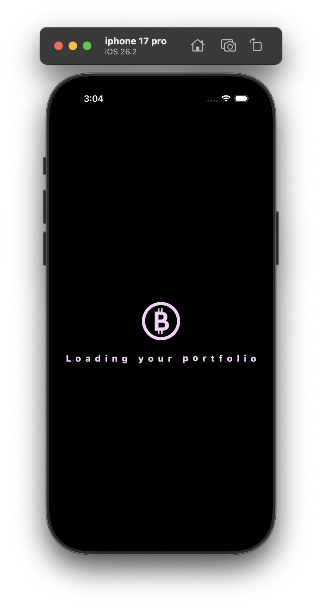
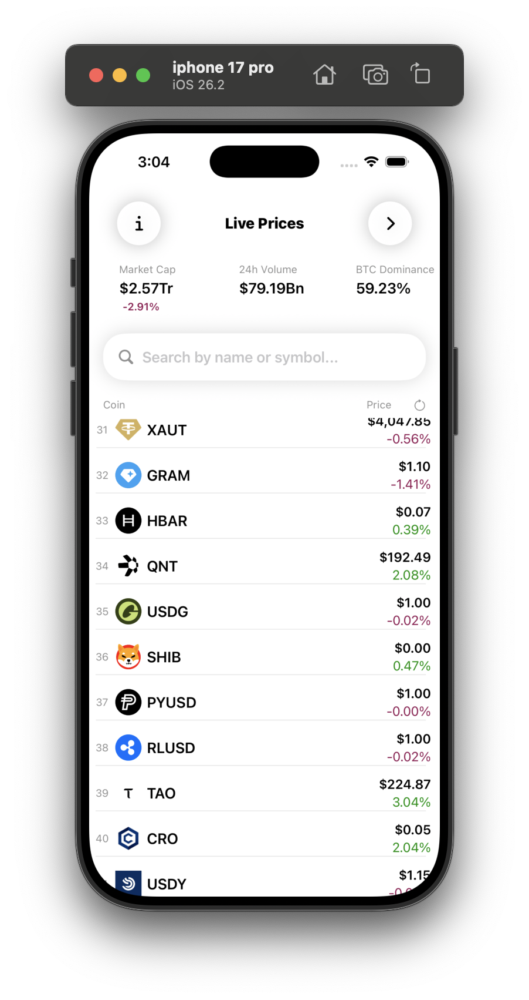
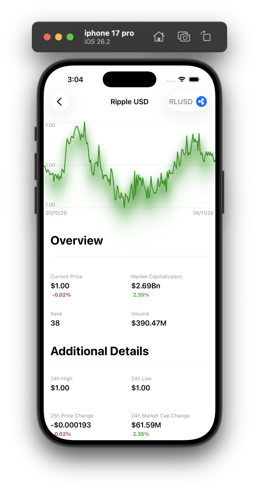
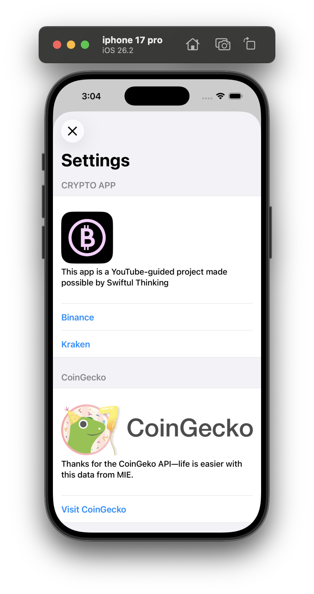

<div align="center">

# 🪙 Crypto Tracker

### A modern, 100% SwiftUI cryptocurrency tracking app for iOS

Track live market data, manage your portfolio, and explore coins with a smooth, fully custom interface.


</div>

---

## 📱 Screenshots

<div align="center">

| Launch | Home | Coin Detail | Settings |
|:---:|:---:|:---:|:---:|
|  |  |  |  |

</div>


---

## ✨ App Features

- 📈 **Live cryptocurrency data** — real-time prices, market cap, and 24h changes
- 💼 **Portfolio management** — save and persist the current user's portfolio
- 🔍 **Search, filter, sort & reload** — find any coin quickly and refresh data on demand
- 🎨 **Custom color theme & loading animations** — a polished, unique look and feel

---

## 🛠 Technical Features

| Area | Implementation |
|---|---|
| **Architecture** | MVVM |
| **Persistence** | Core Data (saving the user's portfolio) |
| **Image Caching** | FileManager (saving images locally) |
| **Reactive Programming** | Combine (publishers & subscribers) |
| **Networking** | Multiple API calls |
| **Data Parsing** | Codable (decoding JSON data) |
| **UI** | 100% SwiftUI interface |
| **Concurrency** | Multi-threading with background threads |
| **Safe Coding** | `if let` and `guard` statements to avoid crashes |

---

## 🏗 Architecture

The app follows the **MVVM (Model–View–ViewModel)** pattern:

```
┌──────────┐     ┌─────────────┐     ┌──────────┐
│   View   │ ◀── │  ViewModel  │ ◀── │  Model   │
│ (SwiftUI)│     │  (Combine)  │     │ (Codable)│
└──────────┘     └──────┬──────┘     └──────────┘
                        │
              ┌─────────┴─────────┐
              │     Services      │
              │ Network • CoreData│
              │   • FileManager   │
              └───────────────────┘
```

- **Views** — declarative SwiftUI components
- **ViewModels** — hold state and business logic, publish updates via Combine
- **Models** — `Codable` structs decoded from API responses
- **Services** — networking, Core Data persistence, and local image caching

---

## 🚀 Getting Started

### Requirements

- Xcode 15 or later
- iOS 16.0+
- Swift 5.9+

### Installation

```bash
# 1. Clone the repository
git clone https://github.com/alex-hort/<your-repo-name>.git

# 2. Open the project
cd <your-repo-name>
open <YourProject>.xcodeproj

# 3. Build and run (⌘ + R)
```

---

## 📂 Project Structure

```
├── Models/
├── ViewModels/
├── Views/
├── Services/
│   ├── NetworkingManager
│   ├── CoreDataManager
│   └── LocalFileManager
├── Utilities/
└── Resources/
```

> Adjust the structure to match your actual folders.

---

## 🧠 What I Learned

- Building scalable apps with **MVVM** and **Combine**
- Persisting data with **Core Data**
- Handling concurrent work safely with **background threads**
- Writing crash-resistant code with **optional binding** and **guard** statements
- Designing a fully custom UI in **SwiftUI**

---

## 👤 Author

**Alexis Horteales**

- GitHub: [@alex-hort](https://github.com/alex-hort)
- LinkedIn: [Alexis Horteales](https://linkedin.com/in/alexis-horteales-66220a260)

---

<div align="center">

⭐ If you like this project, give it a star!

</div>
